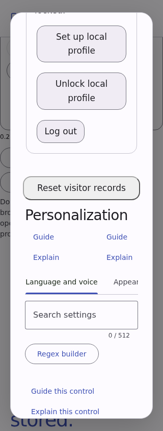
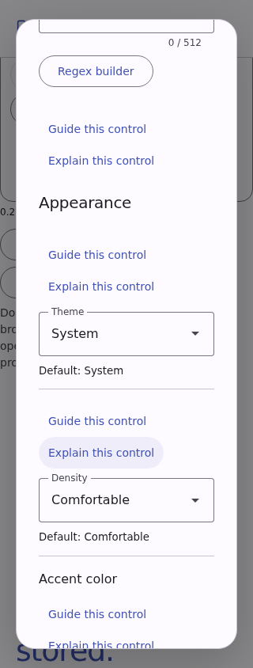
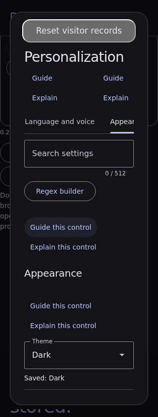
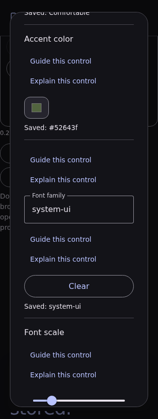
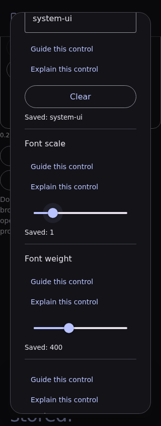
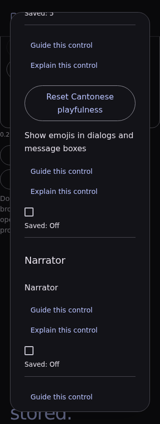
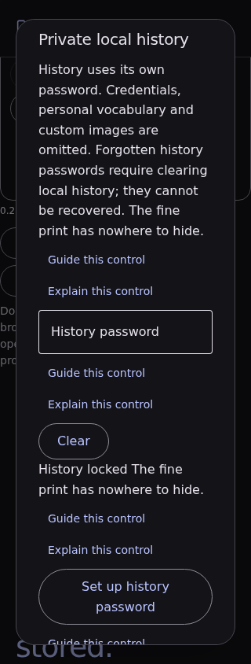
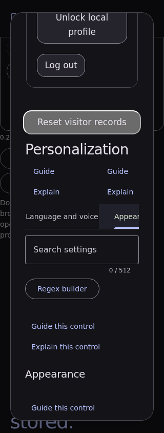

# Material File Encryptor capture gallery

This gallery preserves four application captures from packaged source [`1e16dea8edb66ea5e6cf31009b0dbcc953f18d74`](https://github.com/Ding-Ding-Projects/material-file-encryptor/commit/1e16dea8edb66ea5e6cf31009b0dbcc953f18d74), fourteen partial documentation-page samples bound to source [`b1564bac7cdb6677ff5d9529e65228577d406259`](https://github.com/Ding-Ding-Projects/material-file-encryptor/commit/b1564bac7cdb6677ff5d9529e65228577d406259), and ten product-interface captures from source snapshot [`68ca7f15bfc286d5da960a4c4287f481755455f4`](https://github.com/Ding-Ding-Projects/material-file-encryptor/commit/68ca7f15bfc286d5da960a4c4287f481755455f4). The latest capture set has seven observed scenes and three diagnostic-only records. All dates, image hashes, route details, and limits are in the public inventory. None of these historical images establishes acceptance of later source or releases.

The public gallery is hosted on GitHub Pages at https://ding-ding-projects.github.io/material-file-encryptor-captures/. Anonymous checks returned HTTP 200 for the home, documentation, capture, and provenance pages, all 28 inventory images matched their published SHA-256 values, and the repository About homepage reads back the exact same URL.

## Captures

All images are original PNG bytes. Their hashes, source commits, dimensions, display scales, themes, and available time provenance are listed in [`docs/gallery/captures.md`](docs/gallery/captures.md) and [`captures/inventory.json`](captures/inventory.json). The fourteen documentation images have no validated capture date, so the inventory records it as unavailable.

- [History with a retained synthetic file version](captures/history-preview.png)
- [Recycle Bin with a recoverable synthetic file](captures/recycle-preview.png)
- [Explicit descendant restore dialog](captures/descendant-preview.png)
- [Dark appearance settings](captures/dark-settings-preview.png)

The ten product-interface captures are listed with their exact states, limitations, original hashes, source snapshot, 320 × 844 viewport, 100% scale, capture route, and UTC times in [`captures/inventory.json`](captures/inventory.json). Seven show the requested scene. Three are diagnostic-only because the requested target or editor state was not established; identical diagnostic image bytes remain separately identified in the receipt-derived inventory.

Product interface snapshot, ten original captures

The historical application run recorded 70 passed packaged interface checks and review of 73 captures. Four original images were selected for public viewing. The separate documentation run is partial and remains explicitly unverified for full browser acceptance. The ten product-interface captures are a cloud Playwright observation at source `68ca7f15bfc286d5da960a4c4287f481755455f4`, not native desktop or current-source proof. Four newer images visibly contain machine-profile paths and remain excluded. Other path-bearing captures, generated private announcements, raw receipts, local application archives including `app.asar`, and installers are excluded. The status, limits, and exact image hashes are in the inventory; these records are not evidence about later builds.

## Build

Run `build.bat` to assemble the static gallery in `dist/`. It verifies each source image against the checked-in inventory before copying original bytes. This repository contains no installable product; `build-installer.bat` exits with an honest non-success result and documents that scope.

The capture index is in [`docs/gallery/README.md`](docs/gallery/README.md). There is no HTTP API, so a Postman collection does not apply.

## Site conformance status

The deployed archive page is a focused static gallery. Its universal interactive UI contract remains incomplete and is not represented as satisfied. This build has no language-mode selector or bilingual copy, funny-level controls, dialog-emoji setting, local vocabulary upload, School-mode lock, settings surface, tabbed navigation, regex builder, command palette, appearance editor, notifications, export or bulk-action flow. It also has no persistence for visitor preferences, no full language/theme/scale layout matrix, and no checked-in design reference or parity evidence. The page uses semantic HTML, a keyboard-accessible capture filter, responsive layout, reduced-motion handling, and original image links; those limited behaviors do not close the broader gaps.
