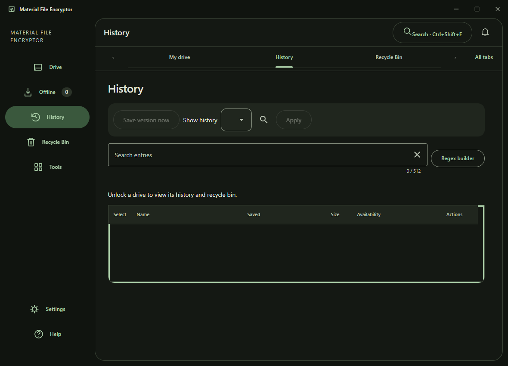
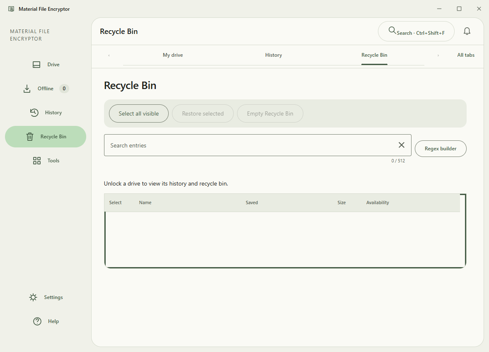
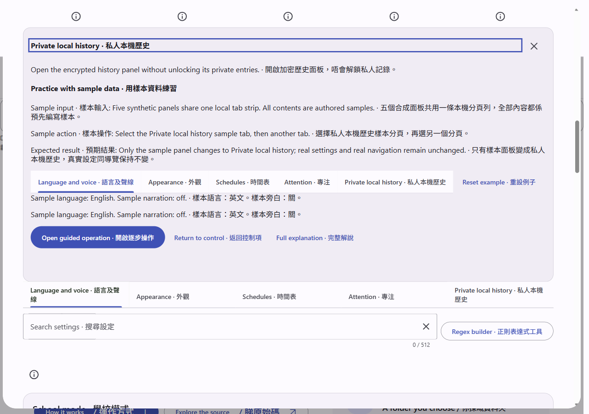
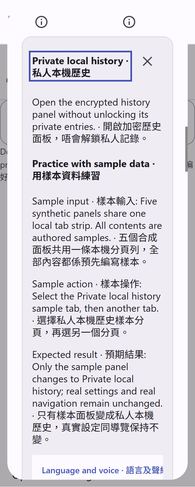
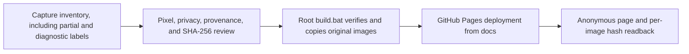

# Material File Encryptor capture gallery

This gallery preserves 76 reviewed original captures, including 46 packaged composition-review images from three distinct source snapshots. The eight focus-after images show an unfinished candidate change and retain the visible limitation that the outline top is covered by the table header. The latest 12 images are bound to product source `56c61a606e28a5c12968eef567a52fc2ad035ebb`, which is now an ancestor of product `main`; the two earlier source snapshots remain historical.

This gallery preserves four historical application captures from packaged source [`1e16dea8edb66ea5e6cf31009b0dbcc953f18d74`](https://github.com/Ding-Ding-Projects/material-file-encryptor/commit/1e16dea8edb66ea5e6cf31009b0dbcc953f18d74), fourteen partial documentation-page samples bound to source [`b1564bac7cdb6677ff5d9529e65228577d406259`](https://github.com/Ding-Ding-Projects/material-file-encryptor/commit/b1564bac7cdb6677ff5d9529e65228577d406259), and ten product-interface captures from source snapshot [`68ca7f15bfc286d5da960a4c4287f481755455f4`](https://github.com/Ding-Ding-Projects/material-file-encryptor/commit/68ca7f15bfc286d5da960a4c4287f481755455f4). It now also includes two inspected bilingual documentation captures from source [`83e14d8627b9782d5acc12221c22ed4f0b8b2d4c`](https://github.com/Ding-Ding-Projects/material-file-encryptor/commit/83e14d8627b9782d5acc12221c22ed4f0b8b2d4c). The older product-interface set has seven observed scenes and three diagnostic-only records. All dates, image hashes, route details, and limits are in the public inventory. These images do not establish native or installed-product acceptance.

The existing public gallery is hosted on GitHub Pages at https://ding-ding-projects.github.io/material-file-encryptor-captures/. The earlier frozen local source object contains 30 original captures, including the two source-83 documentation images; the exact root build passed against that frozen source. The updated deployment, anonymous delivery of the new images, and repository About homepage readback for this update are pending.

## Captures

All images are original PNG bytes. Their hashes, source commits, dimensions, display scales, themes, and available time provenance are listed in [`docs/gallery/captures.md`](docs/gallery/captures.md) and [`captures/inventory.json`](captures/inventory.json). The fourteen partial documentation samples have no validated capture date. The two source-83 guidance captures retain their validated UTC times and emulated-density limitations.

- [History with a retained synthetic file version](captures/history-preview.png)
- [Recycle Bin with a recoverable synthetic file](captures/recycle-preview.png)
- [Explicit descendant restore dialog](captures/descendant-preview.png)
- [Dark appearance settings](captures/dark-settings-preview.png)

## Packaged composition review

The newest review contains 26 baseline images from source snapshot [`4959f2af4a2ced2980b2a68d2ba9fb4056458e35`](https://github.com/Ding-Ding-Projects/material-file-encryptor/commit/4959f2af4a2ced2980b2a68d2ba9fb4056458e35) and eight focus-after images from the separate, unmerged candidate [`f77845127b457fb30692346aae591d9a3501237d`](https://github.com/Ding-Ding-Projects/material-file-encryptor/commit/f77845127b457fb30692346aae591d9a3501237d). Both groups were visually inspected for private pixel content. The candidate improves the visible outline along the sides and bottom, while the table header still covers its top edge. It remains unfinished and is not presented as the current default-branch state.

Only English and DPR 1 browser emulation are represented. The images show empty, locked views; they do not establish populated data, unlocked behavior, physical display scaling, native-window capture, or the full language, theme, and scale matrix. See the [complete inventory](captures/inventory.json) and [capture limitations](docs/gallery/captures.md#packaged-composition-and-keyboard-focus-captures).

## Current documentation guidance captures

The following two original images show bilingual history guidance with isolated synthetic sample controls in the documentation site. They are bound to source [`83e14d8627b9782d5acc12221c22ed4f0b8b2d4c`](https://github.com/Ding-Ding-Projects/material-file-encryptor/commit/83e14d8627b9782d5acc12221c22ed4f0b8b2d4c), with UTC capture times and exact hashes in the public inventory. One uses a 1280 × 900 CSS viewport at 100%; the other uses a 320 × 800 CSS viewport at 200% browser pixel-density emulation. Physical display scaling, native product acceptance, and the full language/theme/scale matrix remain unverified.

The ten product-interface captures are listed with their exact states, limitations, original hashes, source snapshot, 320 × 844 viewport, 100% scale, capture route, and UTC times in [`captures/inventory.json`](captures/inventory.json). Seven show the requested scene. Three are diagnostic-only because the requested target or editor state was not established; identical diagnostic image bytes remain separately identified in the receipt-derived inventory.

Product interface snapshot, ten original captures

The historical application run recorded 70 passed packaged interface checks and review of 73 captures. Four original images were selected for public viewing. The separate documentation run is partial and remains explicitly unverified for full browser acceptance. The ten product-interface captures are a cloud Playwright observation at source `68ca7f15bfc286d5da960a4c4287f481755455f4`, not native desktop or current-source proof. Four newer images visibly contain machine-profile paths and remain excluded. Other path-bearing captures, generated private announcements, raw receipts, local application archives including `app.asar`, and installers are excluded. The status, limits, and exact image hashes are in the inventory; these records are not evidence about later builds.

## Build

Run `build.bat` to assemble the static gallery in `dist/`. It verifies each source image against the checked-in inventory before copying original bytes. This repository contains no installable product; `build-installer.bat` exits with an honest non-success result and documents that scope.

## Publication workflow

The diagram separates source preparation from hosted verification. For the source-83 update, the frozen root build passed; the new live deployment and anonymous readback remain pending.

The capture index is in [`docs/gallery/README.md`](docs/gallery/README.md). There is no HTTP API, so a Postman collection does not apply.

## Site conformance status

The deployed archive page is a focused static gallery. Its universal interactive UI contract remains incomplete and is not represented as satisfied. This build has no language-mode selector or bilingual copy, funny-level controls, dialog-emoji setting, local vocabulary upload, School-mode lock, settings surface, tabbed navigation, regex builder, command palette, appearance editor, notifications, export or bulk-action flow. It also has no persistence for visitor preferences, no full language/theme/scale layout matrix, and no checked-in design reference or parity evidence. The page uses semantic HTML, a keyboard-accessible capture filter, responsive layout, reduced-motion handling, and original image links; those limited behaviors do not close the broader gaps.

The unpublished local history is retained separately. This public snapshot is rooted at the previously published main commit; it does not publish the superseded local history. The earlier local build result stays historical. A fresh exact root build against the sanitized snapshot and live deployment verification remain required before current publication is claimed.

## Full-ring keyboard-focus review

Twelve additional original PNGs are bound to packaged source `56c61a606e28a5c12968eef567a52fc2ad035ebb`. Eight have validated UTC capture times; four scrolled images have no validated per-image time, recorded as unavailable. The images are English-only, light/dark, DPR 1 browser-emulated, and show empty or locked History and Recycle Bin views. The full ring is visible in the scrolled narrow views. The 8 probes cover only the base capture set. Physical display scaling, populated rows, unlocked behavior, and full matrix acceptance are not established.
